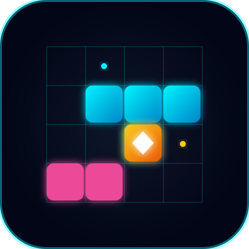

# 🎮 Quantum Grid: Neon Collapse

**Título Comercial**: Quantum Grid: Neon Collapse  
**Gênero / Estilo**: Puzzle de Grid 8x8 (Polyomino Block Collapse)  
**Plataforma**: CrazyGames (HTML5 / WebGL)  
**URL de Produção**: [https://quantumgridneoncollapse.kinomuse.com.br](https://quantumgridneoncollapse.kinomuse.com.br)  
**Desenvolvedor**: Cleber da Silva Gonçalves (FluidCleb Interactive)  
**Data de Publicação**: 24/10/2026  

---

## 📖 1. Lore & Ambientação (2142)

> *No ano de 2142, os fluxos de dados quânticos da megalópole colapsaram. Alinhe os blocos de energia pura para estabilizar o núcleo da rede antes que o sistema reinicie.*

---

## ⚡ 2. Core Gameplay Loop

1. **Bandeja de Peças Quânticas**: O jogador recebe 3 peças poliominó na bandeja inferior (dock dedicado fora do grid).
2. **Arrastar & Encaixar com Offset Tátil**: Suporte total a mouse e touch com elevação de 65px acima do ponto de toque móvel, impedindo que o dedo bloqueie a visualização da grade.
3. **Ghost Snapping em Tempo Real**: Pré-visualização holográfica de encaixe mostrando exatamente onde os blocos serão posicionados.
4. **Colapso Quântico Multi-Linhas**: Linhas e colunas completas colapsam instantaneamente com explosões de partículas, vibração de tela Trauma² e congelamento tátil Hit-Stop.
5. **Combos Consecutivos**: Colapsos contínuos aumentam o multiplicador de pontuação (`COMBO x2`, `x3`, etc.).
6. **Condição de Término & Revive**: Se nenhuma das peças couber na grade 8x8, a rede entra em colapso. O jogador pode acionar um Pulso EMP via Rewarded Ad da CrazyGames para estabilizar o grid e continuar!

---

## 🌟 3. Sistema de 1★, 2★ e 3★ e 15 Setores Progressivos

- **15 Setores Exclusivos**:
  - Setor 01 ao 15 com objetivos crescentes (Pontuação Alvo, Linhas a Colapsar, Purificação de Núcleos Quânticos Embutidos).
- **Aprovação Imediata a 1★**: Ao atingir 1 Estrela, o botão verde pulsante `"✅ CONCLUIR FASE (★) ➔"` surge imediatamente no HUD, permitindo avançar na hora ou continuar em busca de 2★ e 3★!
- **Vitória Máxima a 3★**: Atingir a meta de 3 Estrelas conclui a fase com bônus de créditos quânticos.
- **Modo Matrix Infinita**: Modo clássico de pontuação máxima contínua.

---

## 💰 4. CrazyGames SDK v3 Blindado

- **Watchdog Timeout de 2.5s**: Em caso de bloqueador de anúncios ou lentidão de rede, o jogo retoma automaticamente em 2.5 segundos.
- **Finally Garantido**: Desmuta áudio e despausa a física incondicionalmente.
- **Rewarded Ad 1**: Reviver com Pulso EMP que limpa a área central e concede 3 segundos de escudo.
- **Rewarded Ad 2**: Dobrar moedas ao concluir cada setor ou resgatar missões.
- **Midgame Ads**: Apenas em telas de vitória ou derrota, com intervalo mínimo de 3 a 4 minutos, NUNCA durante a resolução ativa de peças.

---

## 💎 5. Meta-Game, Retenção & Economia

1. **Calendário de Recompensa Diária (7 Dias)**: Bônus progressivos de moedas, power-ups e tema exclusivo *Solar Amber*.
2. **Missões Diárias & Semanais (Quests)**: Desafios dinâmicos com opção de resgate dobrado via anúncio premiado.
3. **Roleta Quântica (Lucky Spin)**: Giro grátis a cada 12 horas e giros extras com Rewarded Ads.
4. **Loja Matrix**: Temas visuais (Cyber Cyan, Synthwave, Matrix Emerald, Solar Amber, Quantum Platinum) e power-ups (Quantum Swap, EMP Blast, Row Laser).

---

## 🛠️ 6. Arquitetura Técnica

- **Engine Web**: Vite + Canvas 2D / WebGL com escala HiDPI via `ResizeObserver` e `devicePixelRatio`.
- **Áudio**: Web Audio API Procedural embutido (zero arquivos externos, zero 404s).
- **Módulos Godot 4.x Companion**:
  - `JuiceCamera2D.gd`: Trauma² screen shake.
  - `HitStopManager.gd`: Pausa tátil de 40-70ms em impactos.
  - `SquashStretch2D.gd`: Deformação elástica com amortecimento harmônico.
  - `EventBus.gd`: Barramento global desacoplado.
  - `SaveManager.gd`: Persistência local versionada.
  - `GridManager.gd`: Validação matricial de tabuleiro 8x8.
